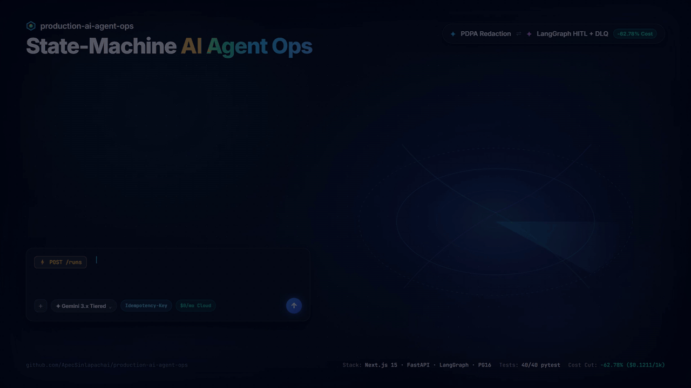
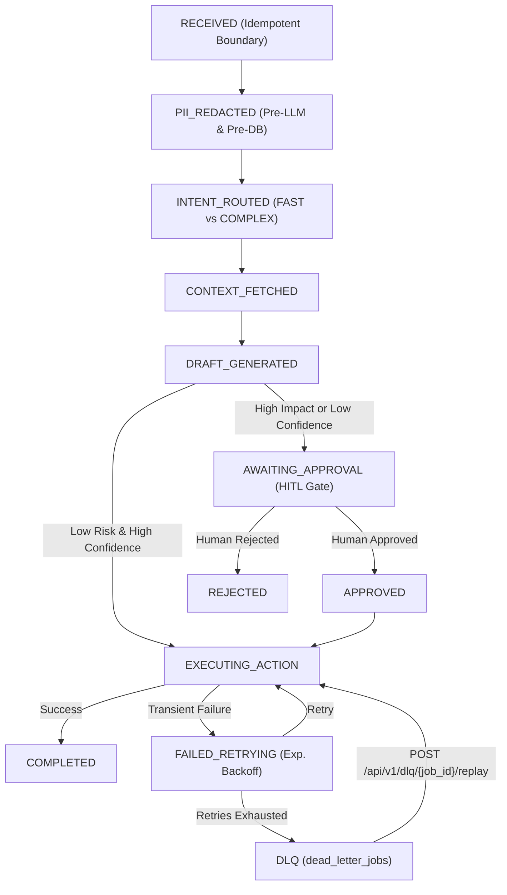

# Production AI Agent Ops

> **A production-minded State-Machine AI Operations Agent** featuring deterministic **LangGraph** state persistence, **PDPA PII Redaction**, **Human-in-the-Loop (HITL) Approval Gates**, **Idempotent Retry + Dead-Letter Queue (DLQ)**, **Tiered Model Routing (`62.78%` verified cost reduction)**, **`n8n` workflow integration**, and a **No-Login Next.js Live Control Plane**.

[](https://github.com/ApecSinlapachai/production-ai-agent-ops/actions/workflows/ci.yml)

- **Live Control Plane (No-Login):** https://apec-ai-portfolio.vercel.app/demos/agent-ops
- **Ask AI about this project:** [Chat with Portfolio Copilot](https://apec-ai-portfolio.vercel.app/chat?scope=production-ai-agent-ops)
- **Live API Swagger Docs:** https://production-ai-agent-ops-api.onrender.com/docs *(Render Free Tier may take ~30–60s on cold start)*



---

## Architecture & Deterministic State Machine

Every run executes through an explicit `LangGraph` `StateGraph` backed by PostgreSQL 16 (`agent_runs` and `agent_state_transitions`) rather than an opaque checkpointer. High-impact actions pause at `AWAITING_APPROVAL` under PostgreSQL `FOR UPDATE` row locking until a human reviewer approves or rejects the action.



---

## Core Capabilities

- **Explicit State-Machine Agent (`LangGraph` + SQL-First Persistence):** Deterministic transitions recorded with actor, model used, routing tier, token counts, cost (USD), and latency (ms) in `sql/001_schema.sql`.
- **PDPA PII Redaction Layer (Pre-LLM & Pre-Log):** Masks Thai National IDs, Thai phone numbers, emails, bank account numbers, and personal names at the API boundary before text is sent to Gemini or persisted to PostgreSQL (`redacted_input` + `redaction_summary` only).
- **Human-in-the-Loop (HITL) Approval Gate:** Refunds, credits, cancellations, and low-confidence actions pause at `AWAITING_APPROVAL` with a structured `action_preview` until explicitly approved or rejected via API or the Next.js Control Plane.
- **Production Reliability Engineering:**
  - `Idempotency-Key` deduplication backed by PostgreSQL unique constraints and payload hash verification (`X-Idempotency-Replayed: true`).
  - Bounded retry with exponential backoff + jitter.
  - Dead-Letter Queue (`dead_letter_jobs`) capture and `FOR UPDATE`-locked manual replay (`POST /api/v1/dlq/{job_id}/replay`).
- **Tiered Model Routing (`62.78%` Cost Reduction):** Routes low-complexity classification/drafting to `gemini-3.5-flash-lite` (`FAST`) and reserves `gemini-3.8-flash` (`COMPLEX`) for high-impact reasoning, with automatic `429` fallback chaining (`gemini-3.1-flash-lite`) and deterministic offline fallback.
- **Public Demo Guardrails:** `AUTH_MODE=demo_sandbox` (no secrets exposed to the browser), IP-hashed (`SHA-256`) sliding-window rate limiting (`429` + `Retry-After`), strict CORS, and `X-Webhook-Secret`-protected `/webhooks/n8n`.
- **`n8n` Workflow Integration:** Ready-to-import workflows in [`n8n/`](./n8n/README.md) for webhook intake, agent dispatch, and HITL callback notifications.
- **No-Login Next.js Live Control Plane (`web/`):** Trigger synthetic TH/EN scenarios, inspect live PDPA redaction diffs and state timelines, approve/reject HITL gates, replay DLQ jobs, and view the live benchmark scorecard.

---

## Verified Benchmark Scorecard (`eval/run_benchmark.py`)

Evaluated across **24 synthetic TH/EN operations cases** (`16 FAST` / `8 COMPLEX`, `32` PII entities redacted):

- **PDPA PII Leak Rate:** `0.00` (`100%` masked before LLM/DB)
- **HITL Policy Enforcement Rate:** `1.00` (all high-impact actions gated at `AWAITING_APPROVAL`)
- **Intent & Routing Accuracy:** `100.00%`
- **CI Gates Passed:** `True`

| Strategy | Models | Est. Cost / 1,000 Runs (USD) | Cost Reduction |
|---|---|---:|---:|
| Always-Frontier Baseline | `gemini-3.8-flash` | `$0.3254` | `0.00%` |
| Tiered Model Routing | `gemini-3.5-flash-lite` + `gemini-3.8-flash` | `$0.1211` | **`62.78%`** |

---

## Tech Stack & Cloud Deployment Architecture

- **Frontend (`web/`):** Next.js 15 (App Router), React 19, TypeScript, Tailwind CSS v4 — target: **Vercel Hobby**
- **Backend (`api/`):** Python 3.12+, FastAPI, Pydantic v2, LangGraph, `psycopg3` (`psycopg_pool`), `google-genai` — target: **Render Free Web Service** (`render.yaml`)
- **Database (`sql/`):** PostgreSQL 16 (Docker Compose locally / **Supabase Free Tier** in production)
- **Automation (`n8n/`):** Exportable `n8n` JSON workflows
- **CI/CD (`.github/workflows/ci.yml`):** Ruff lint, Pytest (unit + live PostgreSQL 16 integration + eval gates), Benchmark CLI gate, Docker build, and Next.js `tsc` + production build.

---

## Local Quickstart

### 1. Start PostgreSQL 16 & FastAPI Backend

```bash
cp .env.example .env
docker compose up --build -d
```

- API Health Check: `http://localhost:8000/health`
- Interactive Swagger Docs: `http://localhost:8000/docs`

*(For local no-login testing with the Next.js frontend, set `AUTH_MODE=demo_sandbox` in `.env` or when running `uvicorn`.)*

### 2. Start the Next.js Control Plane (`web/`)

```bash
cd web
cp .env.example .env.local
npm install
npm run dev
```

Open `http://localhost:3000` in your browser.

---

## Verification Commands

```bash
# Backend lint & tests (inside api/)
ruff check app ../tests ../eval
pytest -v

# Reproducible benchmark gate (repo root)
python eval/run_benchmark.py

# Docker Compose validation (repo root)
docker compose config -q

# Frontend typecheck & production build (inside web/)
npx tsc --noEmit && npm run build
```

---

## Project Governance

See [`AGENTS.md`](./AGENTS.md) for engineering rules, architectural decisions, repository layout, and verification gates.
