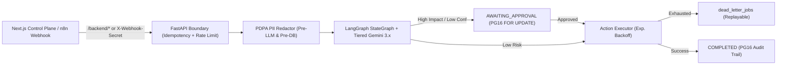

# SPEC — Production AI Agent Ops (`production-ai-agent-ops`)

- **Status:** Shipped
- **Owner:** Apec Sinlapachai
- **Last Updated:** 2026-11-26

---

## 1. Problem & Goal
- **Problem:** Enterprise teams deploying autonomous AI agents for customer operations (refunds, ticket escalations, CRM updates) face four production failure modes: (1) raw customer PII leaking to external LLMs and logs (PDPA violation), (2) autonomous execution of high-impact financial actions without human sign-off, (3) duplicate webhook side-effects and silent transient failures, and (4) runaway frontier-model API costs.
- **Goal:** Deliver a production-minded, `$0`-hosted **State-Machine AI Operations Agent** with deterministic PostgreSQL 16 state persistence, `0.00` PDPA PII leak rate, `1.00` HITL policy enforcement, idempotent retry + DLQ replay, `50–70%` Tiered Model Routing cost reduction (`62.78%` verified), `n8n` integration, and a No-Login Next.js Live Control Plane.

---

## 2. Scope Guardrails (Anti-Scope Creep)
### In-Scope (Must Build)
- [x] Explicit `LangGraph` `StateGraph` backed by SQL-first PostgreSQL 16 transitions (`agent_runs`, `agent_state_transitions`).
- [x] Pre-LLM & Pre-DB deterministic PDPA PII Redaction layer (`pii_redactor.py`) masking Thai National IDs, phones, emails, bank accounts, and personal names.
- [x] Human-in-the-Loop (HITL) Approval Gate pausing high-impact or low-confidence runs at `AWAITING_APPROVAL` with `FOR UPDATE` row locking (`POST /api/v1/approvals/{id}/approve|reject`).
- [x] Production reliability: `Idempotency-Key` deduplication with payload hash verification (`X-Idempotency-Replayed: true`), bounded exponential backoff retries, and Dead-Letter Queue (`dead_letter_jobs`) capture + manual replay (`POST /api/v1/dlq/{job_id}/replay`).
- [x] Tiered Gemini 3.x Model Router (`gemini-3.5-flash-lite` `FAST`, `gemini-3.8-flash` `COMPLEX`, `gemini-3.1-flash-lite` `FALLBACK`, + deterministic offline fallback) with 24-case reproducible benchmark (`eval/run_benchmark.py`).
- [x] Exportable `n8n/` workflow JSONs (`X-Webhook-Secret`-protected `/webhooks/n8n`) and No-Login Next.js 15 Live Control Plane (`web/`) via same-origin `/backend/*` proxy.

### Out-of-Scope (Explicitly Not Building Now)
- Live payment gateway or real banking disbursement execution (simulated deterministic downstream executor for public portfolio safety).
- Multi-tenant OAuth/SSO user management for the public demo (`AUTH_MODE=demo_sandbox` used for public Vercel showcase; `AUTH_MODE=token` supported for private deployments).
- Distributed message broker (Kafka/RabbitMQ) — PostgreSQL `FOR UPDATE` + `dead_letter_jobs` provides transactional reliability within `$0` free-tier constraints.

---

## 3. Architecture & Data Flow

- **Inputs:** `POST /api/v1/runs`, `POST /webhooks/n8n`, `POST /api/v1/approvals/{approval_id}/{approve|reject}`, `POST /api/v1/dlq/{job_id}/replay`. See `api/app/schemas/` for executable contracts.
- **Outputs:** Full `AgentRunResponse` with `redacted_input`, `redaction_summary`, `state_transitions[]`, `action_preview`, token/cost telemetry, and `X-Idempotency-Replayed` header.

---

## 4. Acceptance Criteria (Definition of Done)
1. **Given** a payload containing synthetic Thai/EN PII, **when** processed by `POST /api/v1/runs`, **then** `0` raw PII entities reach the LLM, logs, or PostgreSQL (`PDPA Leak Rate = 0.00`).
2. **Given** a high-impact action (refund, credit, cancellation) or low confidence, **when** drafted by the agent, **then** execution pauses at `AWAITING_APPROVAL` until explicitly approved or rejected (`HITL Enforcement Rate = 1.00`).
3. **Given** a duplicate `Idempotency-Key` or transient downstream failure, **when** submitted, **then** duplicate keys replay the original run (`0` double side-effects) and exhausted retries land in `dead_letter_jobs` for `FOR UPDATE`-locked replay.
4. **Given** `eval/run_benchmark.py` runs across 24 synthetic TH/EN cases, **then** Tiered Routing achieves `50–70%` cost reduction (`62.78%` verified) with `100%` intent/routing accuracy and all CI jobs (`backend-ci` + `frontend-ci`) exit `0`.

---

## 5. Non-Functional Requirements & Guardrails
- **Cost / Quota Cap:** `$0/mo` hosting (Vercel Hobby + Render Free + Supabase Free); IP-hashed rate limiting (`429` + `Retry-After`) + automatic `429` model fallback chain.
- **Security & PDPA:** Zero raw PII persisted; `AUTH_MODE=token|demo_sandbox`; constant-time `X-Webhook-Secret` validation; same-origin `/backend/*` proxy.
- **Observability:** Every state transition, model tier, token count, USD cost, and latency is persisted in PostgreSQL (`agent_runs`, `agent_state_transitions`).
